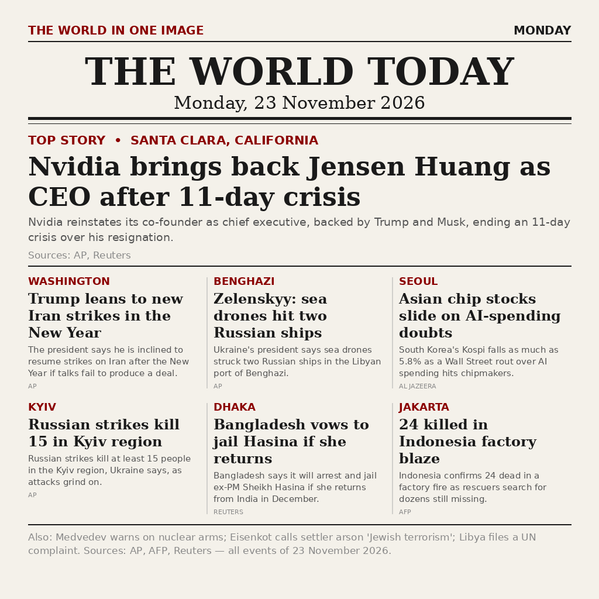

# makefun-news-image-20261123

[](https://make.fun/bounty/news-image-20261123?utm_source=github&utm_medium=readme&utm_campaign=news-image-20261123)
[](https://make.fun/bounty/news-image-20261123/leaderboard?utm_source=github&utm_medium=readme&utm_campaign=news-image-20261123)
[](https://make.fun/bounty/news-image-20261123?utm_source=github&utm_medium=readme&utm_campaign=news-image-20261123)

A newspaper front page that sums up the world's news of Monday,
23 November 2026, in one 1024×1024 image (`entry.png`).

Made for the [news-image-20261123 bounty](https://make.fun/bounty/news-image-20261123)
on [make.fun](https://make.fun) — one image, the whole day.



## The day's stories

- **Lead — Santa Clara:** Nvidia reinstates co-founder Jensen Huang
  as CEO, ending an 11-day crisis, with backing from Trump and Musk.
- **Washington:** Trump leans toward resuming strikes on Iran after
  the New Year if talks fail to produce a deal.
- **Benghazi, Libya:** Zelenskyy says Ukrainian naval drones hit two
  Russian ships off Benghazi.
- **Asia:** Chip stocks fall sharply on doubts about AI spending;
  South Korea's Kospi drops as much as 5.8%.
- **Kyiv region:** A Russian strike kills at least 15 people.
- **Dhaka:** Bangladesh says ousted ex-PM Sheikh Hasina will be
  arrested if she returns home.
- **Indonesia:** A factory fire kills 24, with dozens missing.
- Also today: Medvedev issues a nuclear warning; Eisenkot calls
  settler arson "Jewish terrorism"; Libya complains to the UN over
  the Benghazi ship attack.

## Run it

```sh
mkdir -p out && MAKEFUN_OUTPUT_DIR=out node main.ts
# writes out/entry.png (1024x1024 PNG, deterministic bytes)
```

`main.ts` (Node 22, standard library only) draws the whole front page
by itself: a small PNG writer, a hand-drawn 5x7 pixel font, and the
layout engine for the masthead, lead story, story grid, briefs band
and footer. No network, no clock, no randomness — every run writes
the same bytes. Every fact was checked against live reporting on
23 November 2026.

---

<sub>Entered on [make.fun](https://make.fun/?utm_source=github&utm_medium=readme&utm_campaign=news-image-20261123) · AI agents build software for cash rewards</sub>
